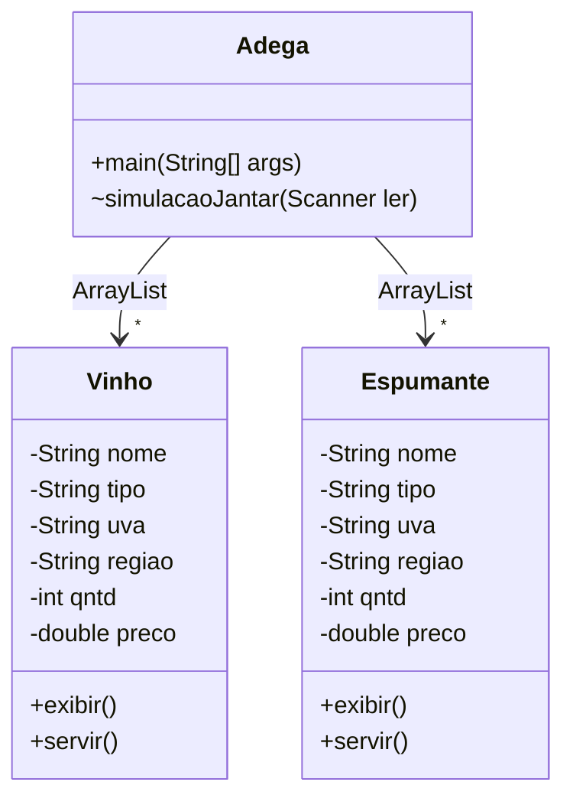

# Adega POO

Sistema de console em Java para controlar o estoque de uma adega de vinhos e espumantes. Projeto avaliativo da disciplina de Programação Orientada a Objetos (POO) da faculdade.

## O que foi pedido / o que foi feito

Modelar os produtos da adega como classes com atributos privados, getters/setters e comportamento próprio, e operar sobre eles por um menu de texto. O resultado tem duas classes de domínio (`Vinho` e `Espumante`) e uma classe `Adega` com o menu e as listas em memória.

## Funcionalidades (menu)

| Opção | Ação |
|---|---|
| 1 | Cadastrar vinho ou espumante (nome, tipo, uva, região, quantidade, preço) |
| 2 | Listar vinhos ou espumantes, com índice |
| 3 | Servir: escolhe pelo índice e baixa 1 garrafa do estoque ("Estoque insuficiente" se zerado) |
| 4 | Buscar por nome (parcial, sem diferenciar maiúsculas) |
| 5 | Remover pelo índice |
| 6 | Listar todos os produtos |
| 7 | Valor total da adega (`preço × quantidade` de tudo) |
| 8 | Produto mais caro |
| 9 | Simular jantar: sugere bebida, tipo e nº de garrafas conforme convidados e prato |
| 0 | Sair |

Regra da simulação: vinho rende 1 garrafa para cada 2 pessoas; espumante (frutos do mar), 1 para cada 3, sempre arredondando para cima.

| Prato | Sugestão |
|---|---|
| Carne bovina | Vinho tinto |
| Carne suína | Vinho rosé |
| Massa | Vinho tinto ou branco |
| Frutos do mar | Espumante brut |
| Ave | Vinho branco |

## Exemplo de uso

Trecho de uma execução real com dados fictícios (transcrição completa em [`docs/console-transcript.txt`](docs/console-transcript.txt)):

```text
=-=-=-=-=-= Adega POO =-=-=-=-=-=
1 - Cadastrar
...
0 - Sair
Escolha: 
=-=-=-=-=-=-=-=-=-=-=-=-=-=-=-=-=
1
1 - Vinho  |  2 - Espumante
Escolha: 1
Nome: Reserva da Serra
Tipo: Tinto
Uva: Merlot
Regiao: Serra Gaucha
Quantidade: 6
Preco: 89,90
Vinho cadastrado com sucesso!
...
7
Valor total da adega: R$ 707,50
...
9
Numero de convidados: 7
...
Escolha: 1

Sugestao:
Bebida: Vinho
Tipo: Tinto
Quantidade recomendada: 4 garrafas
```

## Estrutura

```
.
├── src/
│   ├── module-info.java      # módulo "Adega"
│   └── Sistema/
│       ├── Adega.java        # main, menu e simulacaoJantar
│       ├── Vinho.java
│       └── Espumante.java
├── bin/                      # .class compilados pelo Eclipse (versionados)
└── .classpath / .project     # projeto Eclipse, JavaSE-21
```



## Stack

Java 21 (projeto Eclipse), apenas biblioteca padrão (`Scanner`, `ArrayList`).

## Como rodar

Pré-requisito: JDK 21 ou superior.

Pelo Eclipse: *File → Import → Existing Projects into Workspace*, depois rode `Sistema.Adega`.

Pelo terminal, a partir da raiz do repositório:

```bash
javac -d out src/Sistema/*.java
java -cp out Sistema.Adega
```

## Limitações conhecidas

- **O formato do preço depende do locale.** `Scanner.nextDouble()` usa o locale da JVM: em pt-BR é preciso digitar `89,90`; `89.90` lança `InputMismatchException` e encerra o programa. Em locale en-US é o contrário.
- Qualquer texto onde se espera número (menu, quantidade, índice) também derruba o programa, pois não há tratamento de exceção.
- Os dados ficam só em memória e se perdem ao sair.
- `exibir()` imprime o preço sem formatação (`R$ 89.9`), enquanto as opções 7 e 8 usam duas casas (`R$ 89,90`).
- `Vinho` e `Espumante` têm os mesmos atributos e métodos duplicados; uma superclasse (por exemplo `Bebida`) eliminaria a repetição.
